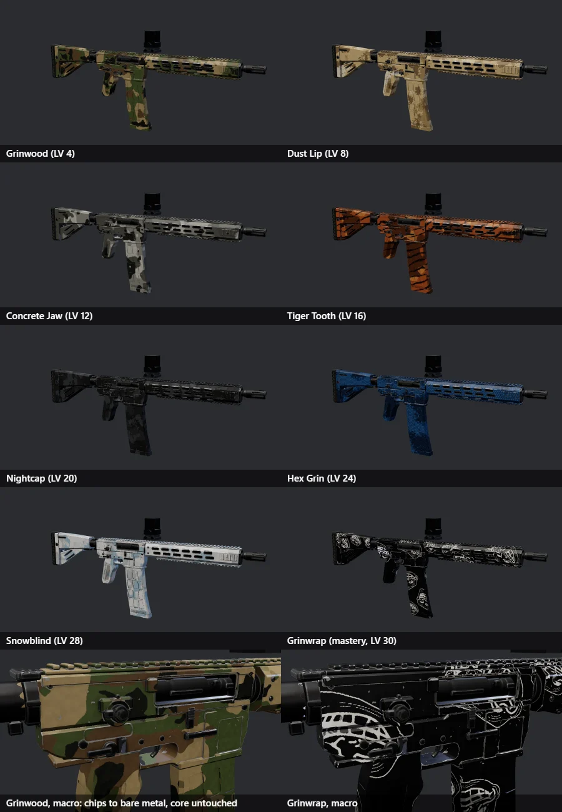
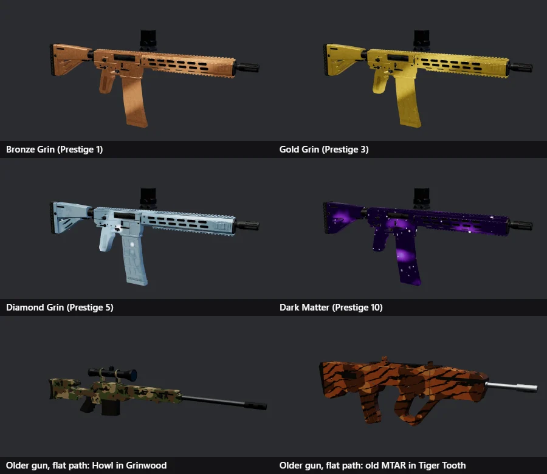
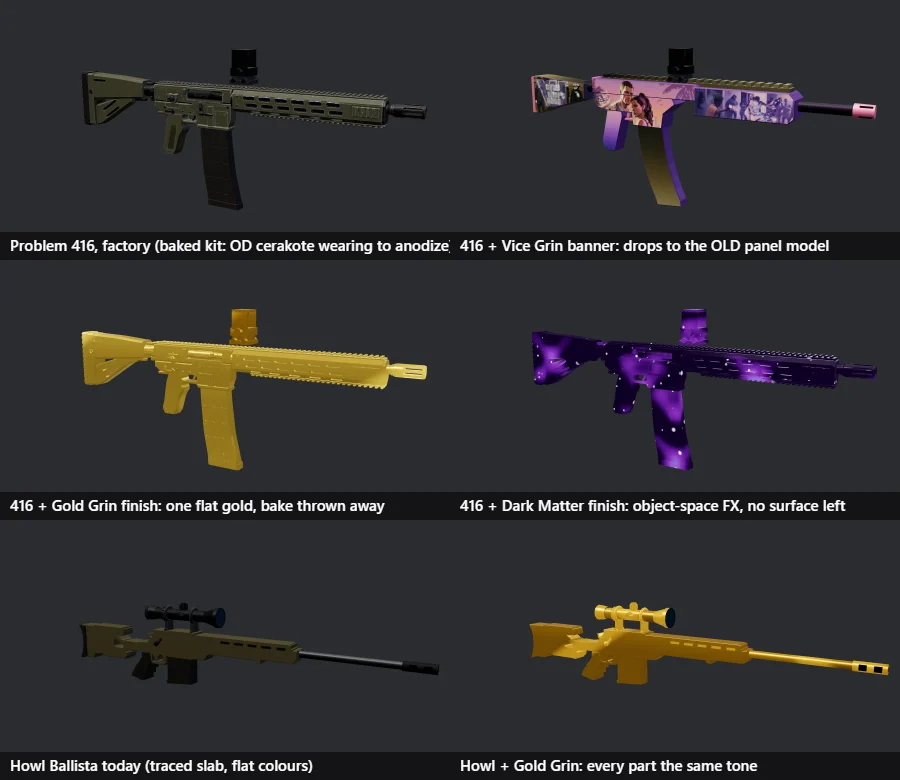
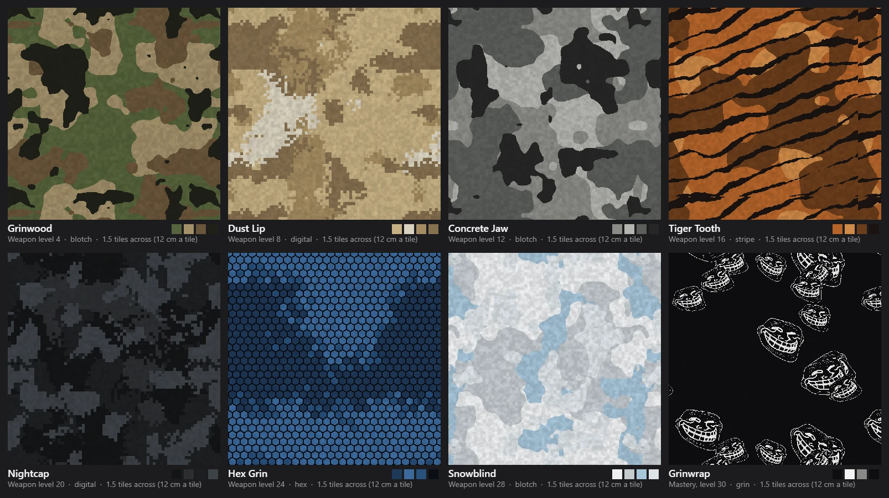

# Troll Warfare: weapon skins (camos) on the arsenal v2 guns

Status: **approved 2026-10-30; phases 0-4 built** on `claude/weapon-skins-359ea8`
(not landed). The 416 wears the whole ladder; the MTAR and Ballista get
their mask with their next full bake. Target guns:
the Problem 416 (live), the MTAR (`claude/arms-mtar`, not landed) and the
Howl Ballista (in progress). Their builders are not touched by this work;
the skins ride on the baked kit every v2 gun already ships.

The look we are after is BO2 and the newer CoDs: a camo that reads as paint
on a real gun, not a colour swap. Our own patterns and names, in that
quality bar, never a copy of an Activision camo.

Built (2026-10-30), on the Problem 416 with its re-baked kit:

Before, for reference:

## 1. What we have (2026-10-30)

Two unrelated skin kinds share the loadout's `skin` slot
(`weapons/attachments.js DEFAULT_LOADOUT`, saved per gun in
`trollops:loadout`, cloud-synced as part of that blob, sent to other
players as wire field `sk`):

- **Banner skins** (`characters/skins.js SKINS`: You Have a Problem, Vice
  Grin). A 1024² atlas painted in the skin editor, mapped onto the OLD
  panelled 416 (`weapons/weapon-416.js`). Equipping one throws the 416
  back to that model (`weapon-model.js buildBaseMesh`): no kit, no moving
  parts, no brass, no LOD1 (sheet, top right). Only the 416 can wear them.
- **Finishes** (`FINISHES`: Ghost Glass, Bronze/Silver/Gold Grin, Diamond
  Grin, Dark Matter; `weapon-model.js applyFinish`). They replace every
  material on the gun wholesale. On a kit gun that discards the baked
  base, ORM and normal maps: Gold Grin is one flat gold over the whole
  416 (sheet, middle left), Dark Matter paints its object-space nebula
  over everything, including steel and rubber. `toneOf` reads
  `material.color`, which is white on a kit material, so every part lands
  on the same tone. Unlocked by prestige only.

What is missing for a real camo:

- The bake (`models/bake_kit.py`) writes three maps per gun (base, orm,
  nrm; 2048² lossy webp, no alpha) and merges every surface into one
  `
_Kit` material. Zone identity (cerakote shell vs anodized core vs
  polymer vs rubber vs steel) and the edge-wear mask the surface group
  computes are baked INTO the base colour and then lost. Nothing tells a
  shader "this pixel is paint" or "this pixel is a chipped edge".
- The UV atlas is smart-projected: islands fragmented and rotated at
  random. A pattern drawn in UV space would show seams and spin on every
  island. (LOD0 and LOD1 do share the layout, which helps.)
- Weapon XP (`progression/weapon-xp.js`, level 1-30 per gun) unlocks
  nothing.

## 2. The target look

What makes a BO2 / modern CoD camo read as real paint, in order of how
much each one matters:

1. **It only covers what paint would cover.** The shell (receiver, lower,
   handguard, stock, grip) takes the camo; the bolt, barrel, rails, pins,
   screws, trigger, butt pad and the inside of the port stay what they
   are. Half of "realism" is the black core still showing through.
2. **Worn edges.** Every chamfer, corner and rail tooth wears through to
   the metal under the paint. The camo wears the same way the factory
   paint does, in the same places, because it IS the factory paint, just a
   different colour.
3. **Roughness changes with the material.** Paint is matte (0.55-0.7),
   bare metal under it is tighter (0.35-0.45), polymer is a little waxier
   than cerakote. A camo that flattens roughness looks like a decal.
4. **Scale.** On a rifle a blotch camo repeats about every 12-15 cm with
   3-6 cm blotches; a digital camo's cell is 6-8 mm; tiger stripes are
   1-2 cm wide. Too small reads as noise, too big as a flag.
5. **Wraps without seams.** The pattern flows over the gun in its own
   space, so the handguard and the receiver agree where they meet, and no
   island edge shows.
6. **It keeps the surface.** AO in the cavities, the grain of the cerakote,
   the stipple on the grip, the waffle on the mag all survive under the
   colour.
7. **Mastery tiers move.** The last tiers have an emissive or sheen layer
   that animates slowly (a sweep every few seconds, not a disco), still
   only on the paintable zones.

## 3. How to apply them: the recommendation

**A fourth baked map (the skin mask) plus a camo shader on a per-skin copy
of the kit material.** The pattern is projected triplanar in gun space at
run time; the bake only says WHERE paint goes and how worn it is.

Why not the alternatives:

- *Per-gun baked camo maps* (one base.webp per gun per camo): 8 camos x
  3 guns x 400 KB = 10 MB of downloads now, 40 guns later, and a re-bake
  of every gun every time a camo changes. Phase 3 of DESIGN-ARSENAL
  wanted "a mask channel lets a skin tint only the shell"; this is that
  mask, done properly.
- *UV-space pattern* on the kit atlas: seams and random rotation per
  island, as above.
- *Object-space FX like Dark Matter today*: no mask, so it paints the
  steel too; and it is per part, so parts disagree at their joins.

### 3.1 The skin mask: `<id>-msk.webp`

`bake_kit.py` gains a fourth EMIT bake from the surface group, written
with the same `_save_gun_webp` but lossless (quality 100), because the
zone channel is stepped and lossy webp would blur the steps:

| Channel | What | Source in `surface_group` |
|---|---|---|
| R | **paint**: 1 on cerakote and polymer, 0 on anodized, parkerized, rubber, brass, glass; stepped (0, 0.5, 1) so a shader can treat polymer (0.5) a touch waxier than cerakote | a new `Paint` group input, defaulted per surface in `SURFACES` |
| G | **wear**: the `wear` node (edge mask x chips, plus Patches), the same value that already chips the base colour to metal | existing node |
| B | **shade**: the `shade` term (AO x grain, 0.72-1.3) that the base colour is multiplied by | existing node |

No builder edits: the defaults live in `SURFACES`, so `bake_gun(...)` on
the existing 416, MTAR and Ballista recipes produces the mask on their
next `bake` run. LOD1 gets its 256 copy through `_shrink` like the others.

**Built: the mask is only ever baked with the other maps.** A mask-only
re-bake of the 416 put a handful of islands (the forward-assist housing,
the port lip, a grip panel) in slightly different places from the shipped
base map: Smart UV is not repeatable run to run. So the 416 was re-baked
whole (`KIT_VER pf3`), and every gun gets its mask from a full bake.

### 3.2 The camo shader (`weapons/camo.js`)

`camoMaterial(kit, lod, skinDef)` clones `kitMaterial(kit, lod)` (same
four maps, cached per `kit:lod:skin`, `userData.shared`) and adds, by
`onBeforeCompile` (the `withFx` pattern already in `weapon-model.js`):

- Gun-space position and normal as two vertex attributes (`camoPos`,
  `camoNrm`), computed once per geometry from each node's rest transform
  (`camoAttributes`), so the mag and the receiver agree at rest and the
  paint moves with the part when it cycles. (Built this way instead of a
  per-node uniform: one shared material can't carry a per-mesh value.)
- **Pattern sample**: the skin's tile sampled three times (xy, yz, xz)
  and blended by |normal|^6: no seams, scale set in metres by
  `uScale`. **Built:** one tile = 22 cm (12 cm read as noise on a rifle:
  seven repeats down the gun); Grinwrap 40 cm so the grins read.
- **Colour**, after `map_fragment`:
  `paint = mask.r * (1 - mask.g * uWear)`;
  `camo = palette[tone] * mask.b`;
  `diffuse = mix(baked, camo, paint)`.
  Chips (mask.g) show the baked base colour, which at those pixels is
  already the worn metal. `uWear` lets a skin wear harder than factory
  (never cleaner: the base is chipped already, which is fine).
  **Built:** the wear is a hard edge (`smoothstep(0.5, 0.62, g)`; its soft
  mid values leaked a third of the factory olive into the paint), a chip
  shows the bake desaturated (bare metal, no olive under a camo), and the
  paint is `value` (0.72) darker than its swatch, plus a faint speckle
  from the detail channel.
- **Roughness / metalness**, after `roughnessmap_fragment` /
  `metalnessmap_fragment`: `mix(baked, skin.rough + tileDetail * 0.1,
  paint)` and `mix(baked, skin.metal, paint)`. Paint is dielectric
  (metal 0); the Chrome / Gold / Silver tiers are the same shader with
  metal 1 and rough 0.2-0.35 on the paint, and the core untouched.
- Normal: the baked normal map, untouched (stipple, waffle and panel
  lines survive).
- **Mastery layer** (optional per skin): an emissive term from the tile's
  G channel and the shared `uFxTime` clock, masked by `paint`.

Cost: one extra 2048 map (512 on touch, 256 at LOD1) plus three samples
of a 512² tile, on one material per gun. Remote players (`mergeHeld`
groups by material) and the killcam get the same material at LOD1.

### 3.3 Tiles and palettes

A camo is a **tile + palette**, not a colour texture: the tile is a
seamless 512² png (lossless: the tone channel is stepped) with R = tone
index (quantised to 4 bands) and G = detail (fibre, speckle, seams, used
for roughness and the mastery sheen); the palette is 4 colours. One
blotch tile gives the woodland, desert and urban colourways for free; the
same goes for the digital and the stripe tiles. Tiles are drawn by
`tools/troll-ops-camo-tiles.mjs` (canvas; every noise lattice wraps and
every stamp is drawn nine times, so the tile repeats without a seam) into
`assets/games/troll-ops/skins/tiles/`. The eight tiles of the ladder,
coloured by their palettes at 1.5 tiles across (the wrap shows):

### 3.4 The older, non-baked guns

Every gun not on a kit (box, traced, hand-coded, old Blender) gets the
same shader on its flat materials, with the mask synthesised: paint = 1
on the material slots that are the gun's body colour (`body`, `over[]`,
the old `MT_Polymer`/`MT_Receiver` names), 0 on steel, dark, glass, glow
and brass; wear from the tile's detail channel thresholded at the skin's
`uWear` (no curvature exists to chip the edges); shade = 1. It reads as
paint on a toy, which is what those guns are until arsenal Phase 2
rebuilds them; the point is that the Skin row in the loadout works for
every gun and the pick carries over when the gun is rebuilt.

### 3.5 Banner skins and the existing finishes

- **Finishes are rebuilt as camos** on the mask: Bronze/Silver/Gold Grin
  become metal paint on the shell (core, rubber, steel stay), Diamond Grin
  and Dark Matter keep their FX layer on top of the new base, masked to
  the paint. Ghost Glass stays a material swap (it is glass, not paint).
  Prestige gates unchanged.
- **Banner skins** stay on the panelled 416 for now (today's behaviour,
  the 416 test's "a banner skin keeps the panelled model"). Phase 4
  moves them onto the kit by a side projection: the sides formula (left
  side reads the atlas top half, right side the bottom half) is exactly
  a planar projection from +-X, so the bake needs no second UV set, only
  an editor mode that lays the regions out at the parts' real side-view
  positions. Not needed for the three target guns; listed so Vice Grin is
  not left behind.

## 4. The ladder

Unlocks hang off **weapon level** (`weapon-xp.js`, 1-30 per gun, already
earned, cloud-synced, unlocking nothing). No per-gun kill or headshot
counters exist locally, so challenge camos ("100 headshots") wait for
counters; prestige finishes stay on prestige. Every gun has the same
ladder, which is one pool of tiles shared by all guns.

| Level | Camo | Tile | Palette / feel |
|---|---|---|---|
| 1 | Factory | — | the gun as baked |
| 4 | **Grinwood** | blotch | olive, brown, tan, black: the classic woodland |
| 8 | **Dust Lip** | digital | sand, khaki, light grey, pale brown |
| 12 | **Concrete Jaw** | blotch | three greys and near-black: urban |
| 16 | **Tiger Tooth** | stripe | brown-orange on black, 1.5 cm stripes |
| 20 | **Nightcap** | digital | matte black, charcoal, gunmetal, with rough 0.75 |
| 24 | **Hex Grin** | hex | small hex cells, two blues and black |
| 28 | **Snowblind** | blotch | white, pale grey, ice blue; wear 1.4 |
| 30 | **Grinwrap** | trollface outline, repeated and rotated | black paint, the grin in the line-art white of the mascot; mastery: a slow sheen sweeps the grins (uFxTime), the first animated camo |
| Prestige 1/2/3 | Bronze / Silver / Gold Grin | — | metal paint on the shell, as today's names |
| Prestige 5 | Diamond Grin | — | the FX layer over an ice-white metal paint |
| Prestige 10 | Dark Matter | — | the nebula over black paint, stars only on the paint |

The Grinwrap grin is the trollface art (`assets/images/icons`), traced
to a one-colour outline tile; never the Unicode glyph. Names, palettes
and the tile designs are ours; none traces an Activision camo.

Menu: the Skin row in `progression/loadout.js renderSkins` lists the
ladder in order with a level badge; locked cards say "Weapon level N"
(prestige ones keep "Unlocks at Prestige N"). Thumbs come from a tool
(`tools/troll-ops-skin-thumbs.mjs`, replacing `troll-ops-finish-thumbs`),
rendered on the 416 kit in the arms-sheet studio.

## 5. Files

| File | Change |
|---|---|
| `models/bake_kit.py` | `Paint` input on the surface group, defaults in `SURFACES`; fourth bake `<id>-msk.webp` (lossless) and `<id>-lod1-msk.webp`; `bake_gun(..., mask=True)` |
| `models/problem416-msk.webp` (+ lod1) | re-bake of the 416 (no builder edit); MTAR and Ballista masks come from their own next bake |
| `weapons/camo.js` (new) | `camoMaterial`, the GLSL, tile loading, the palette uniforms, the flat path for old guns |
| `characters/skins.js` | `CAMOS` table (id, name, tile, palette, rough, metal, wear, scale, level or prestige, fx); `skinsFor` lists camos for every gun; finishes become camo entries |
| `weapons/weapon-model.js` | `buildDetailed` binds `camoMaterial` when the def has a camo and sets `uPartOffset` per node; `applyFinish` shrinks to Ghost Glass; `KIT_VER` bump for the mask |
| `view/viewmodels.js` | stop disposing `userData.shared` materials on swap (it disposes the shared kit material today) |
| `progression/loadout.js`, `style.css` | ladder order, level badge, lock text |
| `progression/weapon-xp.js` | `camoUnlocked(weaponId, camo)` |
| `menu/menu-bo2.js` | the prestige ladder text for the rebuilt finishes |
| `tools/troll-ops-camo-tiles.mjs`, `skins/tiles/*.webp` | the tiles |
| `tools/troll-ops-skin-thumbs.mjs`, `skins/*-thumb.jpg` | menu thumbs |
| `tools/troll-ops-gear-manifest.mjs`, `prefetch-manifest.json` | the mask maps and tiles in the gear list |
| `labs/arms-sheet.html` | `opts.skin` on `shoot` / `orbit` (done, this branch: it made the sheet above) |
| `tools/troll-ops-skins-test.mjs` (new) | the test below |

Untouched: `build_problem416.blender.py`, `build_mtar.blender.py`, the
Ballista builder, `gunkit.py`, the GLBs, the banner editor.

## 6. Phases

0. **Mask bake** (2 h). `bake_kit.py` writes the mask; re-bake the 416;
   open the four maps side by side and check the zone steps are clean at
   island edges (the 16 px bake margin against the 6 px island gap is
   the risk; if steps bleed, the mask bake uses margin 2).
1. **One camo on the 416** (4 h). `camo.js` with Grinwood; screenshot
   head-on, 3/4 and macro at LOD0 and LOD1 in the arms-sheet studio and
   iterate on scale, wear and roughness until it reads as paint; then in
   the real viewmodel (match with No bots). This is the phase to show
   before the rest is built.
2. **The ladder** (4 h). The seven tiles, palettes, Grinwrap with its
   sheen, thumbs, the Skin row on weapon level, cloud save unchanged.
3. **Finishes on the mask** (2 h). Bronze/Silver/Gold as metal paint,
   Diamond and Dark Matter FX masked to paint. The prestige shots in
   the sheet above are the before.
4. **Everyone else** (3 h). The flat path on the old guns, remote players,
   killcam and inspect checked; the MTAR and Ballista masks baked when
   their branches land (one `bake` run each, by the session that lands
   them). Banner skins by side projection only if asked.

Phases 0-1 are one session and one commit per system (bake, then shader).
The ladder and the finishes are separate commits. The MTAR / Ballista
sessions need nothing from this until they land; their builders are not
edited.

## 7. Test plan

`tools/troll-ops-skins-test.mjs` (headless, Supabase blocked, NODE_PATH
to the main checkout), through `labs/arms-sheet.html`:

- Every camo on the 416, LOD0 and LOD1: builds with no page errors, the
  material carries map/orm/nrm/msk and the tile, one draw for the kit.
- Pixel checks on a fixed side shot: the handguard centre is within a
  tolerance of the palette's tones; the port interior and the barrel
  match the factory shot (core untouched); the rail teeth differ from
  the face next to them (edge wear present); LOD1's mean hue on the
  shell matches LOD0's within 8 degrees.
- Roughness: a macro shot of the lower under the key light shows the
  paint's highlight dimmer than the chipped edge's (two pixel reads).
- Old gun (a traced one and a box one): the camo builds, steel and
  glass slots keep their material.
- Loadout: level 3 locks Grinwood, level 4 unlocks it; the pick survives
  `persist()` and reload; prestige entries keep their gate.
- `troll-ops-skin-sync-test.mjs` extended: a remote player's gun and the
  killcam wear the camo at LOD1 through `mergeHeld`.
- `troll-ops-416-test.mjs` still passes (banner branch unchanged,
  `kitMaterial` still shared, viewmodel swap no longer disposes it).
- The arms sheet (`OUT=... GUNS=problem416 node tools/troll-ops-arms-sheet.mjs`)
  stays within budget with the fourth map (LOD0 texMB rises by one map).

Plus the user's eye: a 2x3 sheet like the one above per phase, and the
gun in hand in a private match.

## Open questions (my default in brackets)

- Mastery at level 30 as Grinwrap (the grin pattern), or save the grin
  for a prestige tier and make 30 a plain animated camo? [Grinwrap at 30:
  the brand mark is the reward for finishing a gun]
- Lossless mask at 2048 is about 1 MB a gun. Pack paint into 2 bits and
  accept lossy at 1024 instead? [lossless 2048 for the 416, measure, then
  decide for the rest]
- Keep Ghost Glass? [yes, as the one material swap]
